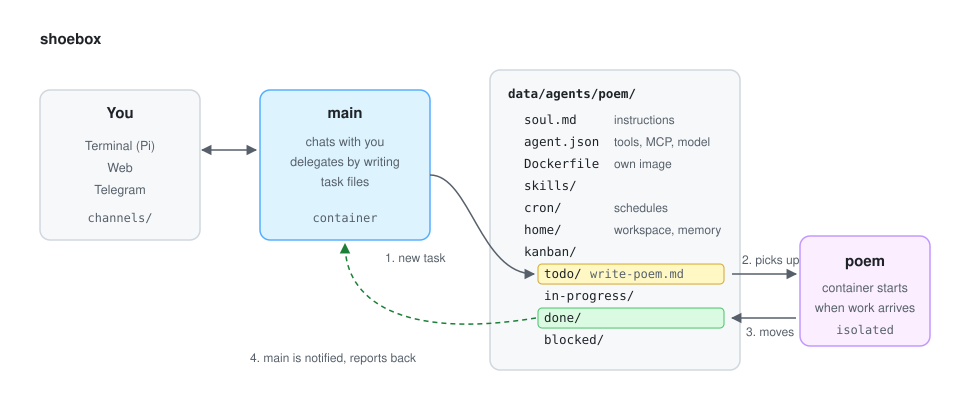
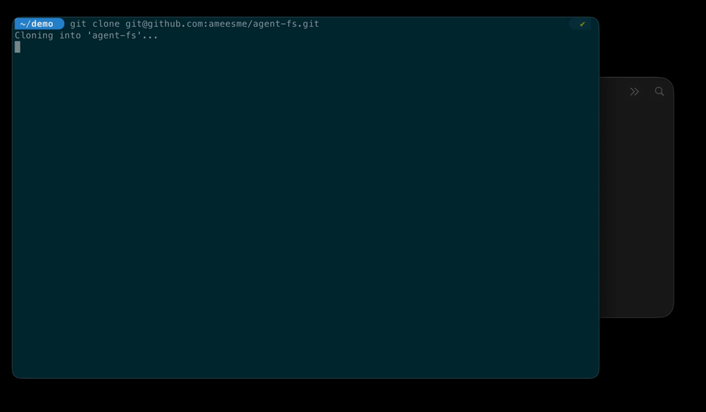
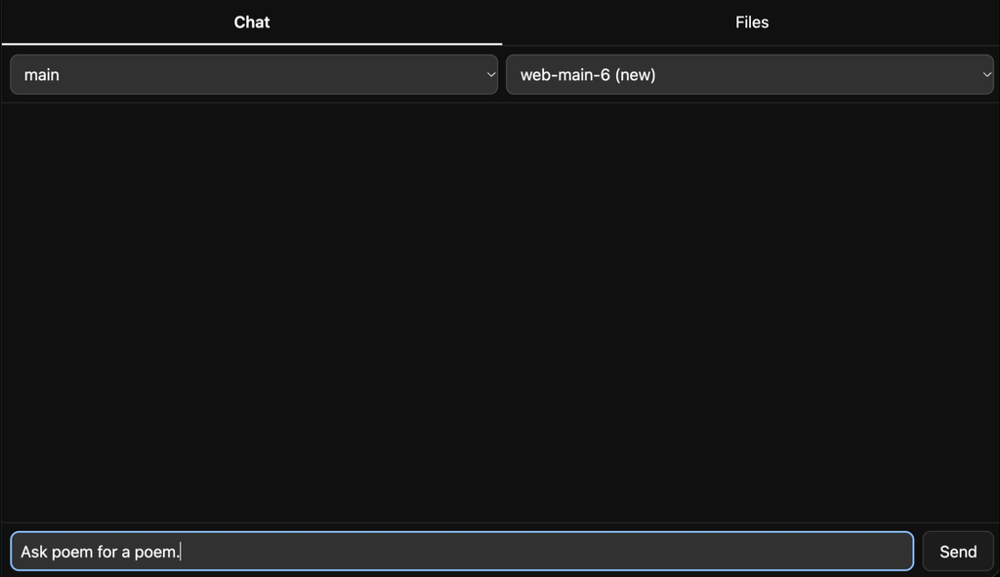

# agentFS

Crazy simple filesystem-based AI agent orchestration.

**Includes**

- A main chat-agent that delegates work and reports back results
- An isolated Docker container and image per agent with a filesystem for
  - Kanban
  - Memory
  - Cron
  - Instructions like Soul.md and skills
  - Persistent workspace
- Pi as harness
- Automatic git versioning for agent definitions, skills, schedules and memory
- Terminal UI, and optional web and Telegram channels
- Main reloads itself to apply changes to its own setup, after you confirm

## In a nutshell

Each agent is a folder with its own instructions, tools and Docker image, where you can define it's skills, soul and tools (by adding them to the Dockerfile). You can chat to each agent, but `main` can easily create and delegate tasks.

Tasks are Markdown files in that agent's `kanban/` folder. Moving a task between `todo`, `in-progress`, `done` and `blocked` changes the task's status.

agentFS starts agent containers automatically as tasks arrive. When a task finishes or gets blocked, `main` is notified and reports back to you.

### Get started in 1 minute

From git-clone to agent-delegation in under a minute. 

## Getting started

- Install Docker and clone this repo
- Copy `data/shared/.env.example` to `data/shared/.env`
- Add your provider's API key, e.g. `OPENAI_API_KEY=your-api-key`.
  See [Pi's provider setup][llm] for other providers
- Run `docker compose up -d --build`
- Run `docker compose exec agents chat` to open Pi's native CLI

### Demo

`poem` is included as an agent by default. As its name suggests, it writes poems, including a cron-based daily poem.

Ask main: `Have poem write a short poem about a quiet morning.` Main will dispatch the task and reports back when it finishes. You can keep chatting while poem works.

## Adding other agents

Ask `main` to create an agent, or add a folder under `data/agents/` yourself. An agent needs;

**soul.md**

The agent's role and instructions in Markdown; Pi uses it as the system prompt.

**agent.json**

`agent.json` is the configuration for Pi, defining the agent's tools, skills, MCP servers and optional model (which wins over `PI_MODEL` in `.env`). Add skills under `skills/` as needed.

MCP servers go under `mcpServers`, as in other MCP clients; `${NAME}` takes a
value from the agent's `.env`.

**Dockerfile**

Use `FROM agent-base` for Pi, Python and the task runtime. Add any other software your agent needs, for example, the included code agent adds Claude Code, tmux and Chromium.

When you start agentFS, it creates each agent's workspace, memory and task folders, and builds the agent's image. It rebuilds the image when its Dockerfile or the base image definition changes.

## Other features
### Cron

Define recurring tasks as Markdown files in each worker's `cron/` folder. Ask
`main` to set up a schedule, or copy [poem's example][daily-poem].

### Shared data
Under `data/shared`, you and agents can share information with each-other that is not a task. For example;
- `.env`: shared credentials; overidden by an agent's own `.env`
- `skills/`: shared skills; overidden by an agent's own skills if names match
- Shared files, like artifacts as a result of a task

Main picks up changes to its own or shared credentials and skills after a reload, which it asks you to confirm first. Changes to the root `.env` or channels need `docker compose up -d --build`.

### Channels

The default way to interact with `main` is through Pi's terminal UI. However, by setting a custom `CHANNEL_COMMAND`, you can enable other ways.

### Telegram
To enable Telegram, update the root `.env` by setting
- `CHANNEL_COMMAND=sh /channels/telegram.sh`
- `TELEGRAM_BOT_TOKEN` or `TELEGRAM_CHAT_BOT_TOKEN`
- `TELEGRAM_CHAT_IDS`

and running `docker compose up -d`.

You can only chat with `main` directly in Telegram. Use `/new` or `/reset` starts a fresh session. **Speech-to-text** is enabled by including an `OPENAI_API_KEY` in your .env.

### Web
To enable agentFS's basic htmx web-interface, update the root `.env` setting
- `CHANNEL_COMMAND=sh /channels/web.sh`
- `COMPOSE_FILE=compose.yaml:compose.web.yaml`

and running `docker compose up -d`. You can now open http://localhost:8080. 

To change the port, you can set `WEB_PORT`. To combine with Telegram, just concatenate its channel command:

`CHANNEL_COMMAND=sh /channels/web.sh sh /channels/telegram.sh`

In the web-interface, you can chat with any agent. Other channels' conversations, such as Telegram, are shown read-only. Files browses agent and shared files, with upload, download and delete, including `.env` files.

## License
Licensed under [MIT](LICENSE)

[llm]: https://github.com/earendil-works/pi/blob/main/packages/coding-agent/docs/providers.md
[daily-poem]: data/agents/poem/cron/daily-poem.md
